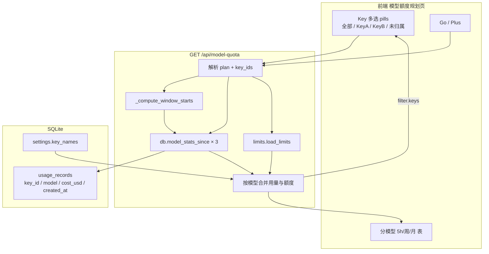

# 模型额度规划：分 API Key + 多选/全部汇总

> **状态**：已实现（2026-10-15，`tests/test_key_filter.py` 覆盖）  
> **仓库**：`D:\opencode-go-gauge`（GoGauge）  
> **范围**：在既有「模型额度规划」页与 `GET /api/model-quota` 上增加 API Key 过滤与合计  
> **相关 WIP**：`app/limits.py`、`app/server.py::_build_model_quota`、`app/db.py::model_stats_since`、`app/web` 配额页

---

## 1. 背景与问题

### 1.1 现有能力（已实现 / WIP）

「模型额度规划」页已经能做：

| 能力 | 说明 |
|------|------|
| 分模型 | 按 `usage_records.model` 聚合 |
| 三窗口 | 5 小时 / 周 / 月（窗口起点优先来自 `go/status` 的 meter） |
| 官方额度对比 | 文档表月额度；5h = 月×20%，周 = 月×50% |
| 计划切换 | Go / Go Plus（影响额度列，不影响用量） |
| 刷新额度表 | `refresh_limits=1` 强制重拉文档缓存 |

用量全部来自本机同步库 `usage_records`（控制台 `request-logs` 同步，含 `key_id`）。

### 1.2 缺口

当前 `_build_model_quota` → `model_stats_since` **只按账号 + 时间窗**聚合，**不区分 API Key**。

多 Key 用户无法回答：

- 「这个 Key 把哪个模型额度吃掉了？」
- 「工作机 + CI 两个 Key 合计用了多少？」
- 「全部 Key 汇总 vs 某一个 Key」对比

### 1.3 产品结论（已确认）

**既要能分 API Key，又要部分 / 全部 Key 的汇总**，即：

1. 单 Key 视图  
2. 多选 Key 的合计视图  
3. 默认「全部」= 不筛 Key（与今天行为一致）

---

## 2. 目标与非目标

### 2.1 目标

1. **分 API Key**：选一个 Key，看该 Key 在各模型上的 5h / 周 / 月 **费用、请求、token** 与相对官方额度的占比  
2. **部分 Key 合计**：多选若干 Key，用量对选中集合 **求和后再按模型出表**  
3. **全部**：不筛 Key（默认），等同当前账号下所有请求汇总  
4. **未归属**：`key_id` 为空的请求可单独筛选（哨兵 `__none__`），与会话页「未归属」语义一致  

### 2.2 非目标（明确不做）

| 不做 | 原因 |
|------|------|
| 按 Key 拆官方额度数字 | 官方额度是账户级，文档未提供 per-key 限额 |
| 改 go/status 仪表 | 仪表仍为账户级官方 %；本页百分比仅规划参考 |
| 改同步逻辑 | `request-logs` 已带 `key_id`，入库已有字段 |
| 跨账号汇总 | 仍只看 `get_active_account_id()` 活跃账号 |
| 服务端持久化筛选状态 | 仅前端 `state.qp.keyIds` 内存态；刷新页面回到「全部」 |

---

## 3. 口径与计算公式

### 3.1 用量（可变：受 Key 筛选）

- 数据源：`usage_records`，`account_id = 活跃账号`  
- 时间窗：与现逻辑相同（`window_starts`：优先 meter `starts_at`，否则 `reset_at - duration`；无配额时本地近 5h/7d，月窗不限）  
- 聚合：`GROUP BY model`，指标与现 `model_stats_since` 一致：  
  - `request_count`  
  - `total_cost_usd`（`SUM(cost_usd)`）  
  - tokens：input（含 cache 读/写）+ output + reasoning 等  

### 3.2 额度（不变：不受 Key 筛选）

```text
monthly_limit  = 文档表[model][go|plus]     # None = 无限
limit_5h       = monthly_limit × 0.20
limit_week     = monthly_limit × 0.50
limit_month    = monthly_limit × 1.00

pct_window     = used_cost_usd / limit_window × 100   # limit 为 None 时 pct = null
remaining_month = max(0, monthly_limit - used_month_cost)
status         = danger if max(pct)≥80 else warn if ≥50 else ok
```

**重要**：多 Key 合计时，`used` 变大而 `limit` 不变 → 占比可能接近或超过「单 Key 时的观感」。这是预期行为，须在 UI 文案中说明：「用量按所选 Key；额度仍为账户级」。

### 3.3 与账户仪表的关系

| 页面/接口 | 百分比含义 |
|-----------|------------|
| 主页 go/status 窗口条 | 官方账户窗口（权威） |
| 本页模型额度规划 | 本地费用 ÷ 文档表规划额度（参考） |

---

## 4. 数据流



---

## 5. 后端设计

### 5.1 常量

```python
NONE_KEY_SENTINEL = "__none__"  # 表示 key_id 为空/NULL 的未归属请求
```

前端与 API 统一使用该字符串；**不得**写入真实 `usage_records.key_id`。

### 5.2 `app/db.py` — `model_stats_since`

#### 签名（建议）

```python
def model_stats_since(
    since_iso: Optional[str] = None,
    account_id: Optional[int] = None,
    key_ids: Optional[list[str]] = None,
) -> list[dict[str, Any]]:
```

#### 过滤语义

| `key_ids` | SQL 行为 |
|-----------|----------|
| `None` 或 `[]` | 不加 `key_id` 条件（全部） |
| 仅普通 id，如 `["abc","def"]` | `AND key_id IN (?, ?)` |
| 仅 `__none__` | `AND (key_id IS NULL OR key_id = '')` |
| 混合，如 `["abc", "__none__"]` | `AND (key_id IN (?) OR key_id IS NULL OR key_id = '')` |

实现注意：

- 参数一律占位符，禁止拼接 id  
- 从列表中拆出 sentinel 与真实 id，再拼 OR 条件  
- 去重、去掉空字符串（空串视为无效，不单独当 `__none__`；客户端应显式传 `__none__`）  
- **行为兼容**：不传 `key_ids` 时结果必须与当前实现完全一致  

#### SQL 骨架（示意）

```sql
SELECT model,
       COUNT(*) AS request_count,
       ...
       SUM(cost_usd) AS total_cost_usd
FROM usage_records
WHERE account_id = ?
  AND datetime(created_at) >= datetime(?)   -- 若 since_iso 非空
  AND (
        key_id IN (?, ?)                    -- 若有真实 id
     OR key_id IS NULL OR key_id = ''       -- 若含 __none__
      )
GROUP BY model
ORDER BY (...tokens...) DESC
```

### 5.3 `app/db.py` — `list_usage_key_ids`

```python
def list_usage_key_ids(account_id: Optional[int] = None) -> dict[str, Any]:
    """返回本账号出现过的 key 信息，供配额页 pill 使用.

    返回示例:
    {
      "keys": ["kid_a", "kid_b"],          # 非空 key_id，按名称/id 排序
      "has_unassigned": True                 # 是否存在 key_id 为空的记录
    }
    """
```

建议实现：

```sql
-- 非空 key
SELECT DISTINCT key_id FROM usage_records
WHERE account_id = ? AND key_id IS NOT NULL AND key_id != ''
ORDER BY key_id;

-- 是否有未归属
SELECT 1 FROM usage_records
WHERE account_id = ? AND (key_id IS NULL OR key_id = '')
LIMIT 1;
```

不必按时间窗再滤一遍：pill 列表展示「本账号历史出现过的 Key」，即使某 Key 在当前 5h 窗内无用量也应可点（点后表可能为空或仅部分模型有数）。

### 5.4 `app/server.py` — `_build_model_quota`

#### 查询参数

| 参数 | 类型 | 默认 | 说明 |
|------|------|------|------|
| `plan` | `go` \| `plus` | `go` | 已有 |
| `refresh_limits` | `0` \| `1` | `0` | 已有 |
| `key_ids` | 逗号分隔字符串 | 空 | 新增；空 = 全部 |

示例：

```http
GET /api/model-quota?plan=go
GET /api/model-quota?plan=plus&key_ids=kid_a
GET /api/model-quota?plan=go&key_ids=kid_a,kid_b,__none__
GET /api/model-quota?plan=go&refresh_limits=1&key_ids=kid_a
```

解析规则：

```python
raw = (query.get("key_ids", [""])[0] or "").strip()
key_ids = [p.strip() for p in raw.split(",") if p.strip()] if raw else []
# key_ids == [] 表示全部
```

#### 构建 `filter.keys` 显示名

对每个真实 `key_id`：

1. `get_key_names().get(kid)` 有则用缓存名（来自 keys 页同步）  
2. 否则用短尾号，例如 `…` + 末 6～8 位（与会话页 `shortId` 风格一致）  
3. `__none__` 的 `name` 可由前端 i18n 覆盖；接口可给 `"未归属"` / 固定英文，前端优先 `t("qpNoKey")`

排序建议：有名称的按名称 locale 排序，无名称按 id；`__none__` 始终放最后。

#### 响应增量（在现有字段上追加）

现有字段保持：`plan`、`logged_in`、`quota_available`、`window_starts`、`limits_source`、`models`、`generated_at` 等。

新增：

```json
{
  "filter": {
    "key_ids": ["kid_a", "kid_b"],
    "keys": [
      { "id": "kid_a", "name": "工作机" },
      { "id": "kid_b", "name": "…a1b2c3d4" },
      { "id": "__none__", "name": "未归属" }
    ]
  },
  "note": "usage_filtered_by_keys_limits_account_wide"
}
```

| 字段 | 含义 |
|------|------|
| `filter.key_ids` | **本次请求实际生效**的筛选列表；`[]` = 全部 |
| `filter.keys` | 可选 Key 目录（含是否展示未归属），供渲染 pills；与是否筛选无关，每次都返回 |
| `note` | 可选机器可读标记；人类说明仍走前端 i18n `qpFilterHint` |

#### 三窗口调用变更

```python
for key, since in starts.items():
    usage[key] = {
        r["model"]: r
        for r in db.model_stats_since(since, aid, key_ids=key_ids or None)
    }
```

合并、排序、status 逻辑不变。

---

## 6. 前端设计

### 6.1 布局（`app/web/index.html`）

建议放在表格卡片上方、标题行下方，单独一行，避免挤爆 `ph-right`：

```html
<section class="page" id="page-quota" hidden>
  <div class="ph">...</div>
  <div class="qp-key-bar">
    <span class="hint" data-i18n="qpFilterHint">...</span>
    <div class="pill-row" id="qp-keys">
      <!-- JS 填充：全部 + 各 Key + 未归属 -->
    </div>
  </div>
  <div class="card qp-card">...</div>
</section>
```

样式：复用现有 `.pill` / `.pill.active` / `.pill-row`；过长时 `flex-wrap`。

### 6.2 状态（`app/web/app.js`）

```js
state.qp = {
  plan: "go",
  seq: 0,
  data: null,
  keyIds: [],   // 空 = 全部；非空 = 多选集合（含可能的 "__none__"）
};
```

### 6.3 交互规则

| 操作 | 行为 |
|------|------|
| 点「全部」 | `keyIds = []`，全部 pill 高亮「全部」，其它取消 active，然后 `loadModelQuota()` |
| 点某个 Key（当前未选） | 加入 `keyIds`，取消「全部」高亮，该 Key active，重载 |
| 点某个 Key（当前已选） | 从 `keyIds` 移除；若删空则回到「全部」语义，重载 |
| 多选 | 允许同时多个 Key active；请求 `key_ids=a,b,c` |
| 切 Go/Plus | 保留当前 `keyIds`，只改 `plan` 重载 |
| 刷新官方额度表 | 保留 `keyIds`，带 `refresh_limits=1` |

不要求「单选模式」与「多选模式」切换开关：一律多选；要看单个就只点一个。

### 6.4 `loadModelQuota` 传参

```js
const q = new URLSearchParams({ plan: state.qp.plan });
if (refresh) q.set("refresh_limits", "1");
if (state.qp.keyIds.length) q.set("key_ids", state.qp.keyIds.join(","));
```

### 6.5 渲染 pills

每次拿到 `data.filter.keys` 后重绘 `#qp-keys`：

1. 第一颗：「全部」—— `active` 当且仅当 `state.qp.keyIds.length === 0`  
2. 其后：`filter.keys` 每一项一颗 pill，`data-v={id}`，文案用 `name`（`__none__` 用 `t("qpNoKey")`）  
3. 若某 `state.qp.keyIds` 已不在 `filter.keys`（Key 被删光历史），渲染时丢弃无效 id，必要时自动回退「全部」  

### 6.6 meta 行

在现有「额度表来源」后追加筛选摘要，例如：

```text
额度表来源: docs · 2026-10-15 · 全部 Key
额度表来源: docs · 2026-10-15 · 工作机
额度表来源: docs · 2026-10-15 · 工作机 + CI (2)
额度表来源: docs · 2026-10-15 · 工作机 + 未归属 (2)
```

规则：

- `keyIds` 空 → `t("qpAllKeys")`  
- 1 个 → 显示该 name  
- ≥2 → `name1 + name2`；超过 2 个可 `name1 + name2 + … (N)`  

### 6.7 i18n（`app/web/app.js` 中英字典）

| Key | 中文 | English |
|-----|------|---------|
| `qpAllKeys` | 全部 Key | All keys |
| `qpNoKey` | 未归属 | Unassigned |
| `qpFilterHint` | 用量按所选 Key 合计；额度仍为账户级（规划参考） | Usage summed for selected keys; limits stay account-wide (planning only) |
| `qpKeysLabel` | API Key | API Key |

已有 `unassigned` 可与 `qpNoKey` 复用同一文案；为配额页语义清晰建议单独键。

可选：微调 `qpNote`，补一句「支持按 API Key 筛选用量」。

---

## 7. API 完整响应示例

### 7.1 全部 Key（默认）

```http
GET /api/model-quota?plan=go
```

```json
{
  "plan": "go",
  "logged_in": true,
  "quota_available": true,
  "quota_error": null,
  "window_starts": {
    "5h": "2026-10-15T01:00:00Z",
    "week": "2026-10-08T00:00:00Z",
    "month": "2026-09-15T00:00:00Z"
  },
  "limits_source": "docs",
  "limits_fetched": "2026-10-15T10:00:00Z",
  "filter": {
    "key_ids": [],
    "keys": [
      { "id": "kid_work", "name": "工作机" },
      { "id": "kid_ci", "name": "CI" },
      { "id": "__none__", "name": "未归属" }
    ]
  },
  "models": [
    {
      "model": "minimax-m2.7",
      "name": "MiniMax M2.7",
      "limit_known": true,
      "monthly_limit_usd": 60,
      "remaining_month_usd": 42.5,
      "windows": {
        "5h": { "requests": 3, "tokens": 12000, "cost_usd": 1.2, "limit_usd": 12.0, "pct": 10.0 },
        "week": { "requests": 20, "tokens": 80000, "cost_usd": 8.0, "limit_usd": 30.0, "pct": 26.7 },
        "month": { "requests": 50, "tokens": 200000, "cost_usd": 17.5, "limit_usd": 60.0, "pct": 29.2 }
      },
      "max_pct": 29.2,
      "status": "ok"
    }
  ],
  "generated_at": "2026-10-15 11:00:00"
}
```

### 7.2 单 Key

```http
GET /api/model-quota?plan=go&key_ids=kid_work
```

`filter.key_ids` 为 `["kid_work"]`；`models[].windows.*.cost_usd` 应 **≤** 全部视图对应值（同窗同模型）。

### 7.3 多 Key + 未归属

```http
GET /api/model-quota?plan=go&key_ids=kid_work,kid_ci,__none__
```

费用约等于分别查询三者后按模型相加（允许浮点四舍五入误差 ≤ $0.01）。

---

## 8. 边界与异常

| 场景 | 处理 |
|------|------|
| 无任何 Key、也无未归属 | `filter.keys = []`；只显示「全部」pill；表与今日一致 |
| 筛选后无模型用量 | `models = []`；表显示「暂无数据」 |
| 请求了不存在的 `key_ids` | 结果为空集即可；pill 仍按库内真实 Key 渲染 |
| 未登录 | 保持现有：窗口起点本地回退；`logged_in: false`；筛选仍可用（纯本地库） |
| Key 名称未同步 | 显示短 id；不影响过滤 |
| URL 过长（极少） | Key 数量通常很少；无需特殊分页 |
| 并发快速点 pill | 沿用现有 `state.qp.seq` 丢弃过期响应 |

---

## 9. 伪代码（落地参考）

下列伪代码贴近现有 `db.py` / `server.py` / `app.js` 风格，可直接对照改。

### 9.1 拼装 key 过滤子句

```python
NONE_KEY_SENTINEL = "__none__"

def _key_filter_sql(key_ids: Optional[list[str]]) -> tuple[str, list[Any]]:
    """返回 (AND 子句含前导空格或 '', 额外参数列表)."""
    if not key_ids:
        return "", []

    real = []
    want_none = False
    seen = set()
    for k in key_ids:
        if not k or k in seen:
            continue
        seen.add(k)
        if k == NONE_KEY_SENTINEL:
            want_none = True
        else:
            real.append(k)

    parts = []
    params = []
    if real:
        placeholders = ",".join("?" * len(real))
        parts.append(f"key_id IN ({placeholders})")
        params.extend(real)
    if want_none:
        parts.append("(key_id IS NULL OR key_id = '')")

    if not parts:
        return "", []
    return " AND (" + " OR ".join(parts) + ")", params
```

### 9.2 `model_stats_since`（增量）

```python
def model_stats_since(since_iso=None, account_id=None, key_ids=None):
    aid = _resolve_account_id(account_id)
    params = []
    clauses = ["account_id = ?"]

    if since_iso:
        clauses.insert(0, "datetime(created_at) >= datetime(?)")  # 或拼进 WHERE
        params.append(since_iso)
    params.append(aid)

    key_sql, key_params = _key_filter_sql(key_ids)
    params.extend(key_params)

    where = " AND ".join(clauses) + key_sql
    rows = get_db().execute(f"""
        SELECT model, COUNT(*) AS request_count, ... , SUM(cost_usd) AS total_cost_usd
        FROM usage_records
        WHERE {where}
        GROUP BY model
        ORDER BY (...tokens...) DESC
    """, params).fetchall()
    # ... 与现逻辑相同，组装 dict 列表返回
```

### 9.3 `list_usage_key_ids`

```python
def list_usage_key_ids(account_id=None) -> dict:
    aid = _resolve_account_id(account_id)
    db = get_db()
    keys = [
        r["key_id"]
        for r in db.execute(
            """SELECT DISTINCT key_id FROM usage_records
               WHERE account_id = ? AND key_id IS NOT NULL AND key_id != ''
               ORDER BY key_id""",
            (aid,),
        ).fetchall()
    ]
    has_unassigned = db.execute(
        """SELECT 1 FROM usage_records
           WHERE account_id = ? AND (key_id IS NULL OR key_id = '')
           LIMIT 1""",
        (aid,),
    ).fetchone() is not None
    return {"keys": keys, "has_unassigned": has_unassigned}
```

### 9.4 `_build_model_quota` 接参与 filter

```python
def _display_key_name(kid: str, names: dict[str, str]) -> str:
    if names.get(kid):
        return names[kid]
    return "…" + kid[-8:] if len(kid) > 8 else kid


def _build_model_quota(query: dict[str, list[str]]) -> dict:
    plan = (query.get("plan", ["go"])[0] or "go").lower()
    if plan not in ("go", "plus"):
        plan = "go"
    refresh_limits = (query.get("refresh_limits", ["0"])[0] or "0") == "1"

    raw = (query.get("key_ids", [""])[0] or "").strip()
    key_ids = [p.strip() for p in raw.split(",") if p.strip()] if raw else []
    # key_ids == []  => 全部（传 None 给 db）

    doc = limits.load_limits(force=refresh_limits)
    limit_map = doc.get("limits") or {}
    aid = db.get_active_account_id()
    # ... 取 token / quota / starts（与现逻辑相同）

    filt = key_ids or None
    usage = {"5h": {}, "week": {}, "month": {}}
    for wkey, since in starts.items():
        usage[wkey] = {
            r["model"]: r for r in db.model_stats_since(since, aid, key_ids=filt)
        }

    # ... 按模型合并额度、算 pct/status、排序（与现逻辑相同）-> rows

    listed = db.list_usage_key_ids(aid)
    names = db.get_key_names()
    filter_keys = [
        {"id": kid, "name": _display_key_name(kid, names)}
        for kid in listed["keys"]
    ]
    # 可选：按 name 排序
    filter_keys.sort(key=lambda x: (x["name"].lower(), x["id"]))
    if listed["has_unassigned"]:
        filter_keys.append({"id": NONE_KEY_SENTINEL, "name": "未归属"})

    return {
        "plan": plan,
        "logged_in": bool(token),
        "quota_available": bool(quota.get("success")),
        "quota_error": ...,
        "window_starts": starts,
        "limits_source": doc.get("source"),
        "limits_fetched": doc.get("fetched") or doc.get("asof"),
        "filter": {"key_ids": key_ids, "keys": filter_keys},
        "models": rows,
        "generated_at": time.strftime("%Y-%m-%d %H:%M:%S"),
    }
```

### 9.5 前端：请求与 pill 交互

```javascript
// state.qp 增加 keyIds: []   // 空 = 全部

async function loadModelQuota(refresh = false) {
  const seq = ++state.qp.seq;
  const q = new URLSearchParams({ plan: state.qp.plan });
  if (refresh) q.set("refresh_limits", "1");
  if (state.qp.keyIds.length) q.set("key_ids", state.qp.keyIds.join(","));
  const data = await api(`/api/model-quota?${q}`);
  if (seq !== state.qp.seq) return;
  state.qp.data = data;
  // 丢掉已不存在的 key
  const valid = new Set((data.filter?.keys || []).map((k) => k.id));
  state.qp.keyIds = state.qp.keyIds.filter((id) => valid.has(id));
  renderKeyPills(data.filter?.keys || []);
  renderModelQuota(data);
}

function renderKeyPills(keys) {
  const row = $("qp-keys");
  const allActive = state.qp.keyIds.length === 0 ? " active" : "";
  let html = `<button class="pill${allActive}" data-v="">${t("qpAllKeys")}</button>`;
  for (const k of keys) {
    const label = k.id === "__none__" ? t("qpNoKey") : k.name;
    const on = state.qp.keyIds.includes(k.id) ? " active" : "";
    html += `<button class="pill${on}" data-v="${escapeHtml(k.id)}">${escapeHtml(label)}</button>`;
  }
  row.innerHTML = html;
  row.querySelectorAll(".pill").forEach((b) => {
    b.addEventListener("click", () => onKeyPillClick(b.dataset.v));
  });
}

function onKeyPillClick(id) {
  // id === "" 表示「全部」
  if (!id) {
    state.qp.keyIds = [];
  } else if (state.qp.keyIds.includes(id)) {
    state.qp.keyIds = state.qp.keyIds.filter((x) => x !== id);
  } else {
    state.qp.keyIds = [...state.qp.keyIds, id];
  }
  loadModelQuota(false);
}

function qpFilterSummary(data) {
  const ids = state.qp.keyIds;
  if (!ids.length) return t("qpAllKeys");
  const nameOf = (id) => {
    if (id === "__none__") return t("qpNoKey");
    const hit = (data.filter?.keys || []).find((k) => k.id === id);
    return hit?.name || id;
  };
  if (ids.length === 1) return nameOf(ids[0]);
  const head = ids.slice(0, 2).map(nameOf).join(" + ");
  return ids.length > 2 ? `${head} + … (${ids.length})` : `${head} (${ids.length})`;
}

// renderModelQuota 里 meta:
// meta.textContent = `${t("qpLimitSource")} ${src} · ${data.limits_fetched} · ${qpFilterSummary(data)}`;
```

### 9.6 端到端（串联）

```text
用户点 pill「工作机」
  -> state.qp.keyIds = ["kid_work"]
  -> GET /api/model-quota?plan=go&key_ids=kid_work
  -> _build_model_quota 解析 key_ids=["kid_work"]
  -> 对 5h/week/month 各调用 model_stats_since(..., key_ids=["kid_work"])
  -> SQL: ... AND key_id IN (?)
  -> 按模型算 cost/pct（额度仍用文档表）
  -> 返回 filter.keys + models
  -> 前端重绘 pills（工作机 active）+ 表格 + meta「… · 工作机」
```

---

## 10. 实现顺序（建议）

1. **`db.model_stats_since` + `list_usage_key_ids`**  
   - 单测或用本地 SQLite 手工 SQL 验证：全部 / 单 / 多 / `__none__` / 混合  
2. **`_build_model_quota` 接参 + `filter` 响应**  
   - 用浏览器或 `curl` 打 `/api/model-quota?key_ids=...`  
3. **前端 pills + `loadModelQuota` 传参 + meta + i18n**  
4. **手工验收**（见 §11）  
5. （可选）补 `tests/` 里针对 `model_stats_since` 的单元测试  

---

## 11. 验收清单

| # | 步骤 | 期望 |
|---|------|------|
| 1 | 打开配额页，不点 Key | 与改前数字一致（同一账号、已同步数据） |
| 2 | 只选 Key A | 各模型费用/请求 ≤ 全部；仅含 A 的用量 |
| 3 | 只选 Key B | 同上，集合与 A 不同（若两 Key 都有流量） |
| 4 | 同时选 A+B | 同模型月费用 ≈ 步骤2 + 步骤3（误差 ≤ 0.01） |
| 5 | 点「全部」 | 回到步骤1 |
| 6 | 选「未归属」（若有） | 仅空 `key_id` 记录 |
| 7 | A+B 后再切 Go↔Plus | 用量不变，额度列随计划变 |
| 8 | 刷新官方额度表 | 筛选保持；来源/时间更新 |
| 9 | 中/英切换 | pill 与 hint 文案正确 |
| 10 | 主页仪表 | 数字不被本功能改动 |

---

## 12. 相关文件一览

| 文件 | 改动要点 |
|------|----------|
| [`app/db.py`](../app/db.py) | `model_stats_since(..., key_ids=)`；新增 `list_usage_key_ids` |
| [`app/server.py`](../app/server.py) | `_build_model_quota` 解析 `key_ids`；组装 `filter`；三窗传入过滤 |
| [`app/web/index.html`](../app/web/index.html) | `#qp-keys` / `qp-key-bar` 容器 |
| [`app/web/app.js`](../app/web/app.js) | `state.qp.keyIds`；`loadModelQuota`；pill 渲染与点击；meta；i18n |
| [`app/web/style.css`](../app/web/style.css)（若有） | `qp-key-bar` 换行间距，尽量复用 pill |
| [`app/limits.py`](../app/limits.py) | **不改** |
| [`tests/`](../tests/) | 建议补 `model_stats_since` 过滤用例 |

---

## 13. 修订记录

| 日期 | 说明 |
|------|------|
| 2026-10-15 | 初版：分 Key + 多选/全部汇总设计定稿 |
| 2026-10-15 | 扩充：口径、SQL、API 示例、交互、边界、验收 |
| 2026-10-15 | 增加 §9 伪代码：key 过滤、db、API、前端、端到端 |
| 2026-10-15 | 实现完成：`db.model_stats_since(key_ids=)` / `list_usage_key_ids` / `/api/model-quota?...&key_ids=` / 前端 pills + meta + i18n；`tests/test_key_filter.py`；接受清单 §11 全部通过（浏览器端到端 + pytest 62 项） |
